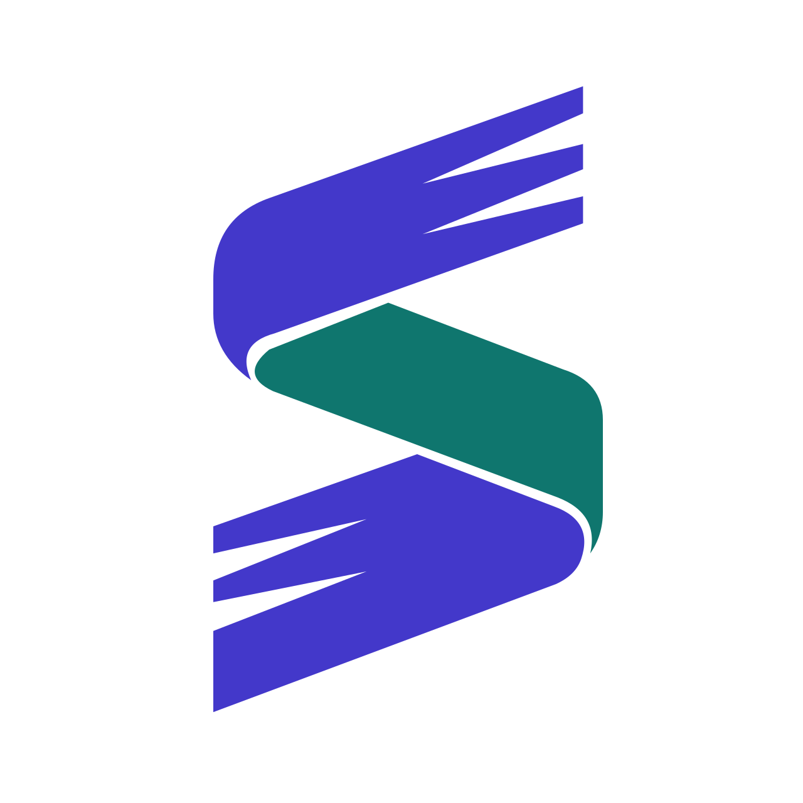
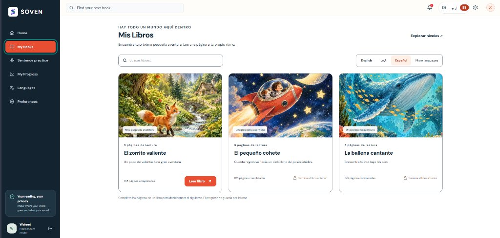
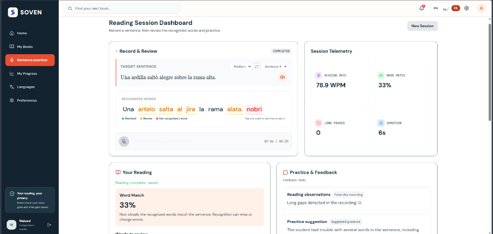
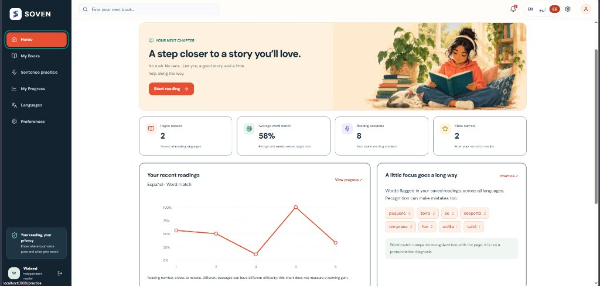
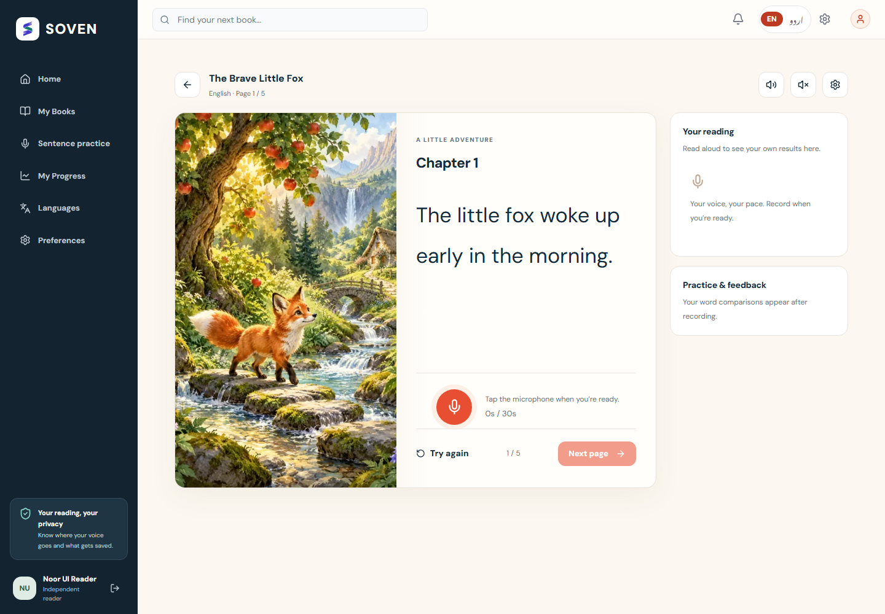
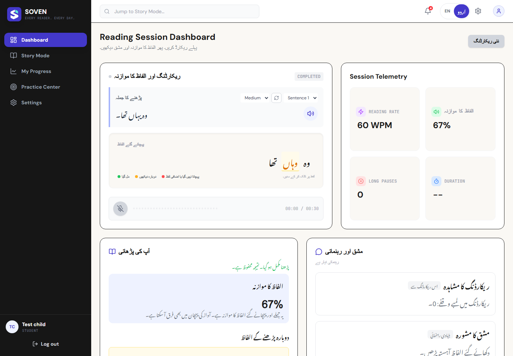
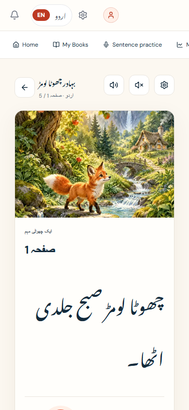
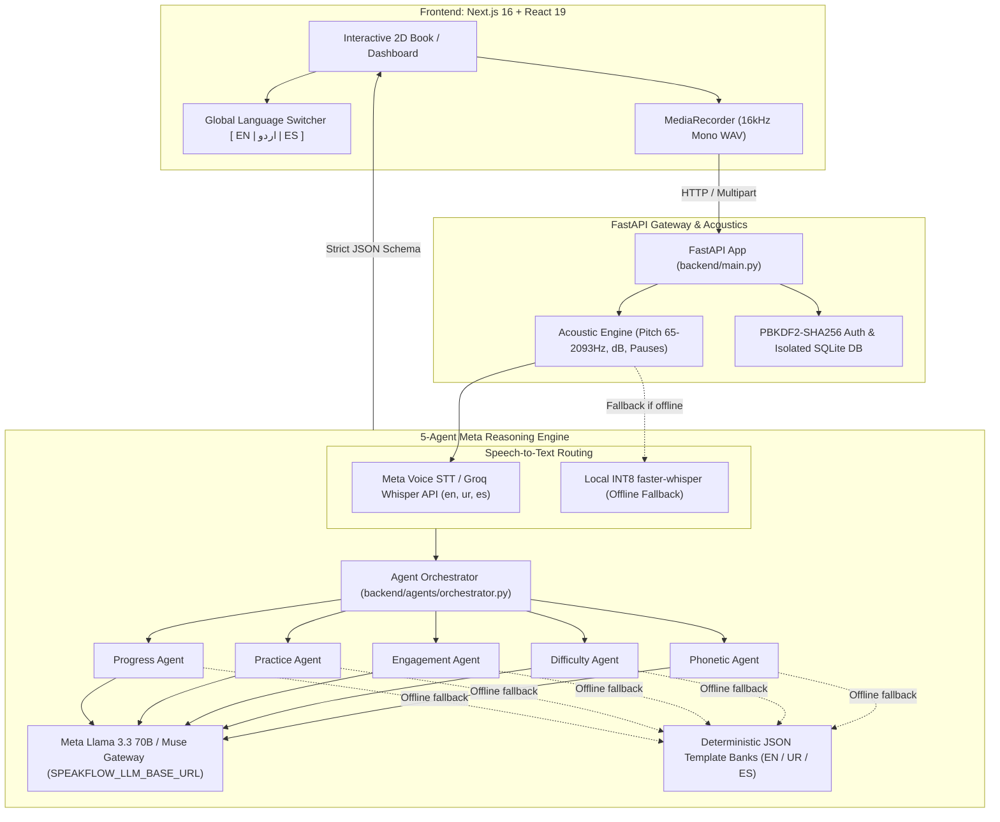

<div align="center">
  
  
  # SOVEN (SpeakFlow 2.0)
  ### *Empathetic, Multilingual AI Reading Coach & Illustrated Storybook Platform*
  
  <p align="center">
    <b>Empowering children, readers with dyslexia, and teachers in 50-student classrooms with real-time 1-on-1 phonetic guidance, active English, Urdu, & Spanish reading tracks, and an edge architecture scaling to 70+ languages.</b>
  </p>

  <!-- Shields.io Badges -->
  <p align="center">
    <a href="https://github.com/TeamXOF/soven"></a>
    <a href="https://nextjs.org"></a>
    <a href="https://fastapi.tiangolo.com"></a>
    <a href="https://www.python.org"></a>
    <a href="https://www.typescriptlang.org"></a>
    
    
    <a href="LICENSE"></a>
  </p>

  <!-- Interactive Anchor Navigation -->
  <p align="center">
    <a href="#-the-problem--the-solution">💡 The Problem</a> •
    <a href="#-visual-showcase">📸 Visual Showcase</a> •
    <a href="#-core-feature-pillars">✨ Key Features</a> •
    <a href="#-road-to-70-languages-the-multilingual-engine">🌍 70+ Languages Engine</a> •
    <a href="#-architecture--multi-agent-system">🏗️ Architecture</a> •
    <a href="#-tech-stack-breakdown">💻 Tech Stack</a> •
    <a href="#-quick-start">⚡ Quick Start</a> •
    <a href="#-verification--automated-tests">🧪 Verification</a> •
    <a href="#-roadmap">🗺️ Roadmap</a>
  </p>
</div>

---

## 💡 The Problem & The Solution

### The 50-Student Classroom Literacy Crisis
In underserved schools across South Asia, Latin America, and developing regions worldwide, a **single teacher commonly manages 40 to 50 students** in a 45-minute reading period. That leaves **less than 1 minute of individual reading evaluation per child per day**. 

Struggling readers and the **1 in 5 children with dyslexia** inevitably slip through the cracks unnoticed. Teachers physically cannot listen to every child read aloud, while existing commercial software relies on rigid countdown timers that provoke anxiety and demands constant cloud connectivity that disconnected classrooms cannot sustain.

### The SOVEN Solution
**SOVEN** acts as a patient, 1-on-1 virtual reading specialist sitting at every student's desk:
1. **Listens & Assesses in Real-Time:** Detects hesitations (>0.8s) and phonetic substitutions without ever grading children punitively.
2. **Dyslexia-First Storybooks:** Features tactile 2-page book spreads, cream paper tints, syllable splits, and waived speed deductions so readers focus on phonemic accuracy rather than beating a clock.
3. **Active Trilingual Production (English, Urdu, Spanish):** Children switch between English, Right-to-Left Urdu Nastaliq, and Spanish with native sentence banks, phoneme confusion models, and neural audio guidance.
4. **Teacher Roster Triage:** Aggregates reading telemetry (WCPM, pitch stability, pause frequency) into an actionable classroom roster, highlighting exactly which children need human teacher intervention that day.
5. **Autonomous 5-Agent Meta Pipeline:** Powered by Meta Llama 3.3 70B / Muse across Phonetic, Difficulty, Engagement, Practice, and Progress agents to generate structured feedback in under 2 seconds.
6. **100% Offline Edge Resilience:** Runs locally on classroom laptops with local INT8 Whisper and deterministic template banks when cloud connectivity drops.

---

## 📸 Visual Showcase

<div align="center">

| 🇪🇸 Spanish Illustrated Bookshelf (*Mis Libros*) | 🇪🇸 Spanish Sentence Practice & Live Telemetry |
| :---: | :---: |
|  |  |
| *Full Spanish bookshelf (*El zorrito valiente*, *El pequeño cohete*, *La ballena cantante*) with instant language filter.* | *Live Spanish sentence practice (*Una ardilla saltó alegre sobre la rama alta*) with word match, WPM, and acoustic feedback.* |

| 📈 Spanish Reader Progress & Word Review | 📖 2D Open Storybook & Syllable Splits |
| :---: | :---: |
|  |  |
| *Longitudinal Spanish accuracy chart with flagged vocabulary review chips (*pequeño*, *zorro*, *despertó*).* | *Tactile 2-page open book spread with center spine, cream paper aesthetic, and accessible syllable splits.* |

| 🇵🇰 Urdu Nastaliq & RTL Multilingual Support | 📱 Mobile & Responsive Story Mode |
| :---: | :---: |
|  |  |
| *Right-to-left Nastaliq script support with native phoneme confusion mapping and Urdu neural audio coach.* | *Responsive single-column layout collapse designed for handheld tablets and smartphones.* |

</div>

---

## ✨ Core Feature Pillars

### 1. 🇪🇸 🇵🇰 🇬🇧 Trilingual Production (Spanish, Urdu Nastaliq, English)
- **Spanish (`es-ES`):** Native storybook collection (*El zorrito valiente*, *El pequeño cohete*, *La ballena cantante*), 15 checkpoint assessments, Spanish syllable breaking, and full sentence practice banks across Easy, Medium, and Hard tiers.
- **Urdu (`ur-PK`):** Right-to-Left Nastaliq font integration with South Asian phonetic confusion matrices and native Urdu audio coaching.
- **English (`en-US`):** Full phoneme alignment, phonological awareness drills, and storybook paths.
- **Global Topbar Switcher:** Instantly toggle between `[ EN | اردو | ES ]` from anywhere in the app to switch stories, sentence drills, speech recognition, and synthesized speech.

### 2. 📖 Tactile 2D Storybooks & Dyslexia Mode
- **Cream Paper & Center Spine Aesthetic:** Eliminates harsh screen glare with warm reading tones and gentle book typography.
- **Syllable Segmentation:** Breaks complex words into accessible phonemic chunks (e.g., *ex · plo · ra · ción*, *a · ven · tu · ra*).
- **Zero Speed Penalties:** In Dyslexia Mode, WCPM timing deductions are completely waived, prioritizing reading confidence over pace.

### 3. 🎙️ 20-Second Pre-Signup Acoustic Diagnostic
- **Frictionless Onboarding:** Visitors evaluate reading ability in 20 seconds before creating an account.
- **Signal Analysis (65–2093 Hz):** `librosa`-powered acoustic engine analyzes vocal pitch stability, pause frequency (>0.4s), and decibel loudness.
- **Privacy Shield:** 100% of temporary audio is processed in-memory and immediately destroyed. Zero raw student audio is ever retained on servers.

### 4. 🤖 Autonomous 5-Agent Meta AI Pipeline
When a child completes a reading attempt, `backend/agents/orchestrator.py` launches a parallel 5-agent reasoning pipeline powered by **Meta Llama 3.3 70B / Muse**:
- **Phonetic Agent:** Aligns transcribed words against the target text, identifying vowel substitutions, omissions, and phonetic confusions across languages.
- **Difficulty Agent:** Dynamically shifts story difficulty up or down based on word match accuracy and hesitation density.
- **Engagement Agent:** Analyzes pacing and generates warm, culturally affirming words of encouragement.
- **Practice Agent:** Formulates targeted, single-sentence drills isolating the specific phonetic sound the child struggled with.
- **Progress Agent:** Updates longitudinal mastery tracking and generates teacher summary notes.

### 5. 🔌 True Offline Edge Resilience
- **Disconnected School Guarantee:** If internet connectivity drops or an API key is absent, SOVEN automatically shifts to:
  - Local cached INT8 `faster-whisper` for on-device speech-to-text.
  - Deterministic JSON template banks (`backend/data/feedback_templates.json`) in English, Urdu, and Spanish for pedagogical advice.

---

## 🌍 Road to 70+ Languages: The Multilingual Engine

SOVEN was architected from inception not as a hardcoded three-language app, but as a **scalable global literacy platform targeting 70+ languages**. 

Our shared language registry (`shared/languages.json`) currently inventories **89 distinct languages** with script directions (LTR vs. RTL), default orthographies (Latin, Arabic/Nastaliq, Devanagari, Cyrillic, Hanzi, etc.), and strict gatekeeper contracts.

```
┌────────────────────────────────────────────────────────────────────────┐
│               SOVEN 5-Gate Language Promotion Protocol                 │
├───────────────────┬────────────────────────────────────────────────────┤
│ 1. Content Gate   │ Storybooks & tiered sentence banks authored        │
│ 2. Speech Gate    │ STT route validated (Cloud Whisper or local edge)  │
│ 3. Alignment Gate │ Script-aware segmentation & syllable tokenization  │
│ 4. Coaching Gate  │ Multilingual LLM prompts & offline template banks  │
│ 5. Interface Gate │ Native typography, bidirectional layout & TTS voice│
└───────────────────┴────────────────────────────────────────────────────┘
```

### Automated Cross-Language Type Synchronization
To prevent runtime type drift across the Python backend and TypeScript frontend, SOVEN includes an automated contract generator:
```bash
python tools/build_language_types.py --check
```
This guarantees that `backend/core/language_types.py` (Pydantic models) and `frontend/lib/language-types.ts` (TypeScript union types) remain in 100% lockstep whenever a new language passes its acceptance gates.

---

## 🏗️ Architecture & Multi-Agent System



### Pakistan Geographic Policy & Global Deployment Compliance
Meta's hosted API (`api.meta.ai`) imposes regional restrictions for direct accounts in Pakistan. To address this seamlessly:
- Soven introduces `SPEAKFLOW_LLM_BASE_URL`.
- **Hackathon Judges:** Can run the platform pointing directly to hosted Meta endpoints (`api.meta.ai/v1`).
- **Regional Schools:** Seamlessly route to containerized open weights (Baseten, Modal, Fireworks, or local vLLM) without modifying a single line of backend application code.

---

## 💻 Tech Stack Breakdown

| Layer | Technology | Rationale |
| :--- | :--- | :--- |
| **Frontend Framework** | Next.js 16.2.10 (Turbopack) | Fast server-side rendering, sub-second route transitions, and robust static page generation. |
| **UI Components** | React 19 + Tailwind CSS | Fluid responsive 2-page book spread with tactile page curls and accessible high-contrast modes. |
| **Audio Processing** | Web Audio API + Librosa | Real-time browser audio recording coupled with backend pitch-tracking and hesitation detection. |
| **Backend API** | Python 3.12/3.13 + FastAPI | High-throughput asynchronous REST gateway with automatic OpenAPI documentation. |
| **Database** | SQLite + PBKDF2-SHA256 | Local zero-configuration relational storage enforcing strict privacy and zero cloud data leaks. |
| **Reasoning Engine** | Meta Llama 3.3 70B / Muse Spark | Industry-leading instruction adherence for structured Pydantic JSON multi-agent pipelines. |
| **Speech-to-Text** | Whisper Large v3 + INT8 Edge | Sub-1.5s cloud transcription with instant fallback to on-device edge transcription. |

---

## ⚡ Quick Start

### Prerequisites
- **Python:** Version 3.12 or 3.13
- **Node.js:** Version 20.9+ (or LTS)
- **FFmpeg:** Installed and added to system `PATH` (for audio processing)

### 1. Clone the Repository
```bash
git clone https://github.com/TeamXOF/soven.git
cd soven
```

### 2. Backend Setup
```bash
# Navigate to backend and create virtual environment
cd backend
python -m venv .venv

# Windows activation:
.venv\Scripts\activate
# macOS/Linux activation:
# source .venv/bin/activate

# Install dependencies
pip install -r requirements.txt -r requirements-dev.txt

# Configure environment
cp .env.example .env

# Bootstrap classroom administrator (prompts for your secure password)
python scripts/bootstrap_teacher.py --username teacher

# Start FastAPI backend
python -m uvicorn main:app --host 127.0.0.1 --port 8000 --reload
```

### 3. Frontend Setup
In a second terminal window:
```bash
cd frontend
npm ci
npm run dev
```

Open **[http://localhost:3000](http://localhost:3000)** in your browser to explore the landing page, pick your language (`EN`, `UR`, `ES`), and start reading!

---

## 🧪 Verification & Automated Tests

Soven features a comprehensive testing suite guaranteeing zero regressions across authentication, multi-agent reasoning, acoustics, and multilingual pipelines.

```bash
# Run backend regressions and provider adapter validations
python backend/tests/test_regressions.py
python backend/tests/test_speech_capabilities.py
python backend/tests/test_reasoning_providers.py

# Run exhaustive 13-feature live endpoint verification
python backend/tests/test_exhaustive_suite.py

# Validate language inventory and TypeScript contracts
python tools/build_language_types.py --check

# Frontend linting, type-checking, and production build
cd frontend
npm run lint
npx tsc --noEmit
npm run build
```

---

## 🗺️ Roadmap & Milestones

- [x] **Phase 1: Core Foundation & Privacy Architecture**
  - [x] Zero-retention ephemeral audio processing.
  - [x] PBKDF2-SHA256 authenticated classroom and student scopes.
  - [x] Offline-first SQLite persistence with versioned schema migrations.
- [x] **Phase 2: Tactile 2D Storybook & Acoustic Diagnostics**
  - [x] 2-Page open book spread with tactile cream aesthetics and mobile collapse.
  - [x] Syllable segmentation and Dyslexia Mode (waived speed penalties).
  - [x] 20-Second pre-signup acoustic diagnostic test (`/onboarding/test`).
- [x] **Phase 3: Autonomous Multi-Agent Reasoning & Trilingual Expansion**
  - [x] 5-Agent Meta Llama 3 / Muse pipeline (Phonetic, Difficulty, Engagement, Practice, Progress).
  - [x] Live Voice Coach turn trigger on hesitations (>0.8s).
  - [x] Full Spanish (`es`) reading path alongside English (`en`) and Nastaliq Urdu (`ur`).
  - [x] `SPEAKFLOW_LLM_BASE_URL` gateway for Pakistan Geographic Use Policy compliance.
- [ ] **Phase 4: Global Scale & Classroom Hardware**
  - [ ] Staged rollout expanding from active 3 to **70+ languages** using the 89-language inventory.
  - [ ] Raspberry Pi 5 plug-and-play classroom edge box.
  - [ ] Automated classroom-to-classroom encrypted sync mesh.

---

## 📄 License & Attribution

Distributed under the **MIT License**. See [`LICENSE`](LICENSE) for complete details.

**Origin & Attribution:**  
SOVEN is developed by **Waleed Khalid** and **TeamXOF**, evolving from our earlier work on SpeakFlow Mesh. Submitted to the **Meta Global AI Developer Hackathon (Theme 1: Build for Your World)**.
