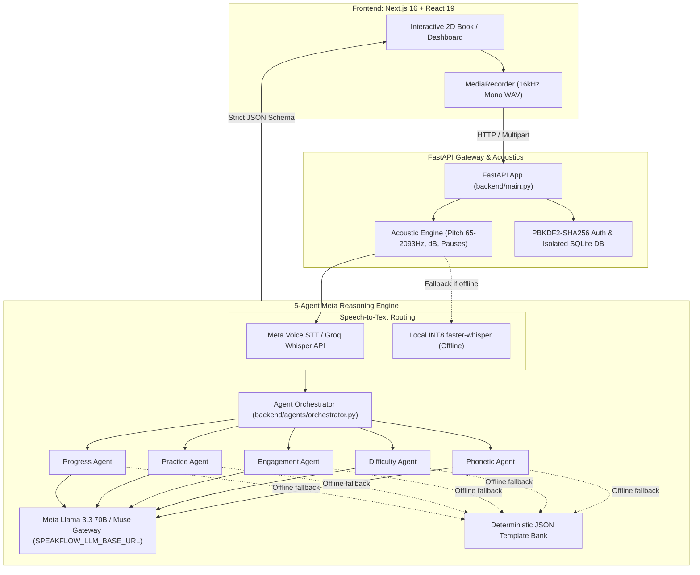

<div align="center">
  
  
  # SOVEN (SpeakFlow 2.0)
  ### *Empathetic, Trilingual AI Reading Coach & Illustrated Storybook Platform*
  
  <p align="center">
    <b>Empowering children, readers with dyslexia, and teachers in 50-student classrooms with real-time 1-on-1 phonetic guidance and offline-first edge intelligence.</b>
  </p>

  <!-- Shields.io Badges -->
  <p align="center">
    <a href="https://github.com/TeamXOF/soven"></a>
    <a href="https://nextjs.org"></a>
    <a href="https://fastapi.tiangolo.com"></a>
    <a href="https://www.python.org"></a>
    <a href="https://www.typescriptlang.org"></a>
    
    <a href="LICENSE"></a>
  </p>

  <!-- Interactive Anchor Navigation -->
  <p align="center">
    <a href="#-the-problem--the-solution">💡 The Problem</a> •
    <a href="#-visual-showcase">📸 Visual Showcase</a> •
    <a href="#-core-feature-pillars">✨ Key Features</a> •
    <a href="#-architecture--multi-agent-system">🏗️ Architecture</a> •
    <a href="#-tech-stack-breakdown">💻 Tech Stack</a> •
    <a href="#-quick-start">⚡ Quick Start</a> •
    <a href="#-verification--automated-tests">🧪 Verification</a> •
    <a href="#-roadmap">🗺️ Roadmap</a>
  </p>
</div>

---

## 💡 The Problem & The Solution

### The Classroom Literacy Crisis
In underserved schools across South Asia, Latin America, and developing regions worldwide, a **single teacher commonly manages 40 to 50 students** in a standard 45-minute reading period. Mathematically, that leaves **less than 1 minute of individual reading time per child per day**. 

Struggling readers and the **1 in 5 children with dyslexia** inevitably slip through the cracks. Teachers physically cannot listen to every student, while commercial reading apps enforce punitive countdown timers that trigger anxiety and rely on constant high-speed cloud internet that rural classrooms simply do not have.

### The SOVEN Solution
**SOVEN** acts as a patient, 1-on-1 virtual reading specialist sitting at every desk:
1. **Listens & Assesses in Real-Time:** Detects hesitations (>0.8s) and mispronunciations without ever scoring children punitively.
2. **Dyslexia-First Storybooks:** Features tactile 2-page book spreads, cream paper tints, syllable splits, and waived speed deductions so children focus on phonemic accuracy rather than beating a clock.
3. **Teacher Roster Triage:** Aggregates reading telemetry (WCPM, pitch contours, pause counts) into an actionable classroom roster, highlighting exactly which children need human teacher intervention that day.
4. **Autonomous 5-Agent Meta Pipeline:** Multi-agent pipeline powered by Meta Llama 3 / Muse orchestrating phonetics, adaptive difficulty, emotional encouragement, and targeted drills in under 2 seconds.
5. **100% Offline Edge Resilience:** Runs locally on classroom hardware with local INT8 Whisper and deterministic template banks when cloud connectivity drops.

---

## 📸 Visual Showcase

<div align="center">

| 📖 2D Open Storybook & Syllable Splits | 🎙️ Sentence Practice & Real-Time Feedback |
| :---: | :---: |
|  |  |
| *Tactile 2-page open book spread with center spine, cream paper aesthetics, and phonemic syllable breaks.* | *Live sentence practice with instant word-match accuracy, WCPM telemetry, and audio replay.* |

| 🌍 Urdu Nastaliq & Multilingual Support | 📱 Mobile & Responsive Story Mode |
| :---: | :---: |
|  |  |
| *Full right-to-left Nastaliq script support with native phoneme confusion mapping and Urdu audio coach.* | *Responsive single-column layout collapse for handheld tablets and smartphones.* |

</div>

---

## ✨ Core Feature Pillars

### 1. 📖 Tactile 2D Storybooks & Dyslexia Mode
- **Cream Paper & Center Spine Aesthetic:** Eliminates harsh screen contrast with warm reading tones and gentle book typography.
- **Syllable Segmentation:** Breaks complex words into accessible phonemic chunks (e.g., *ex · plo · ra · tion*).
- **Zero Speed Penalties:** In Dyslexia Mode, WCPM timing deductions are completely waived, prioritizing reading confidence over pace.

### 2. 🎙️ 20-Second Pre-Signup Acoustic Diagnostic
- **Frictionless Onboarding:** Visitors evaluate reading ability in 20 seconds before creating an account.
- **Signal Analysis (65–2093 Hz):** `librosa`-powered acoustic engine analyzes vocal pitch stability, pause frequency (>0.4s), and decibel loudness.
- **Privacy Shield:** 100% of temporary audio is processed in-memory and immediately destroyed. Zero raw student audio is ever retained on servers.

### 3. 🤖 Autonomous 5-Agent Meta AI Pipeline
When a child completes a reading attempt, `backend/agents/orchestrator.py` launches a parallel 5-agent reasoning pipeline powered by **Meta Llama 3.3 70B / Muse**:
- **Phonetic Agent:** Aligns transcribed words against the target text, identifying vowel substitutions, omissions, and phonetic confusions.
- **Difficulty Agent:** Dynamically shifts story difficulty up or down based on word match accuracy and hesitation density.
- **Engagement Agent:** Analyzes pacing and generates warm, culturally affirming words of encouragement.
- **Practice Agent:** Formulates targeted, single-sentence drills isolating the specific phonetic sound the child struggled with.
- **Progress Agent:** Updates longitudinal mastery tracking and generates teacher summary notes.

### 4. 🌍 Trilingual Mastery (English, Urdu Nastaliq, Spanish)
- **English (`en-US`):** Full storybook library and phonetic alignment.
- **Urdu (`ur-PK`):** Right-to-Left Nastaliq font integration with specialized South Asian phonetic confusion matrices.
- **Spanish (`es-ES`):** Complete trilingual story collection (*El zorrito valiente*, *El pequeño cohete*, *La ballena cantante*) with Spanish syllable tokenization and TTS audio guidance.

### 5. 🔌 True Offline Edge Resilience
- **Disconnected School Guarantee:** If internet connectivity drops or an API key is absent, SOVEN automatically shifts to:
  - Local cached INT8 `faster-whisper` for on-device speech-to-text.
  - Deterministic JSON template banks (`backend/data/feedback_templates.json`) for pedagogical advice.

---

## 🏗️ Architecture & Multi-Agent System



### Pakistan Geographic Policy & Global Deployment Compliance
Meta's hosted API (`api.meta.ai`) imposes regional restrictions for direct accounts in Pakistan. To address this seamlessly:
- Soven introduces `SPEAKFLOW_LLM_BASE_URL`.
- **Hackathon Judges:** Can run the platform pointing directly to hosted Meta endpoints (`api.meta.ai/v1`).
- **Regional Schools:** Seamlessly route to containerized open weights (Baseten, Modal, Fireworks, or local vLLM) without modifying a single line of backend application code.

---

## 💻 Tech Stack Breakdown

| Layer | Technology | Rationale |
| :--- | :--- | :--- |
| **Frontend Framework** | Next.js 16.2.10 (Turbopack) | Fast server-side rendering, sub-second route transitions, and robust static page generation. |
| **UI Components** | React 19 + Tailwind CSS | Fluid responsive 2-page book spread with tactile page curls and accessible high-contrast modes. |
| **Audio Processing** | Web Audio API + Librosa | Real-time browser audio recording coupled with backend pitch-tracking and hesitation detection. |
| **Backend API** | Python 3.12/3.13 + FastAPI | High-throughput asynchronous REST gateway with automatic OpenAPI documentation. |
| **Database** | SQLite + PBKDF2-SHA256 | Local zero-configuration relational storage enforcing strict privacy and zero cloud data leaks. |
| **Reasoning Engine** | Meta Llama 3.3 70B / Muse Spark | Industry-leading instruction adherence for structured Pydantic JSON multi-agent pipelines. |
| **Edge STT** | Faster-Whisper (INT8) | Instant offline speech transcription running locally without requiring external cloud servers. |

---

## ⚡ Quick Start

### Prerequisites
- **Python:** Version 3.12 or 3.13
- **Node.js:** Version 20.9+ (or LTS)
- **FFmpeg:** Installed and added to system `PATH` (for audio processing)

### 1. Clone the Repository
```bash
git clone https://github.com/TeamXOF/soven.git
cd soven
```

### 2. Backend Setup
```bash
# Navigate to backend and create virtual environment
cd backend
python -m venv .venv

# Windows activation:
.venv\Scripts\activate
# macOS/Linux activation:
# source .venv/bin/activate

# Install dependencies
pip install -r requirements.txt -r requirements-dev.txt

# Configure environment
cp .env.example .env

# Bootstrap classroom administrator (prompts for your secure password)
python scripts/bootstrap_teacher.py --username teacher

# Start FastAPI backend
python -m uvicorn main:app --host 127.0.0.1 --port 8000 --reload
```

### 3. Frontend Setup
In a second terminal window:
```bash
cd frontend
npm ci
npm run dev
```

Open **[http://localhost:3000](http://localhost:3000)** in your browser to explore the landing page and start reading!

---

## 🧪 Verification & Automated Tests

Soven features a comprehensive testing suite guaranteeing zero regressions across authentication, multi-agent reasoning, acoustics, and multilingual pipelines.

```bash
# Run backend regressions and provider adapter validations
python backend/tests/test_regressions.py
python backend/tests/test_speech_capabilities.py
python backend/tests/test_reasoning_providers.py

# Run exhaustive 13-feature live endpoint verification
python backend/tests/test_exhaustive_suite.py

# Validate language inventory and TypeScript contracts
python tools/build_language_types.py --check

# Frontend linting, type-checking, and production build
cd frontend
npm run lint
npx tsc --noEmit
npm run build
```

---

## 🗺️ Roadmap & Milestones

- [x] **Phase 1: Core Foundation & Privacy Architecture**
  - [x] Zero-retention ephemeral audio processing.
  - [x] PBKDF2-SHA256 authenticated classroom and student scopes.
  - [x] Offline-first SQLite persistence with versioned schema migrations.
- [x] **Phase 2: Tactile 2D Storybook & Acoustic Diagnostics**
  - [x] 2-Page open book spread with tactile cream aesthetics and mobile collapse.
  - [x] Syllable segmentation and Dyslexia Mode (waived speed penalties).
  - [x] 20-Second pre-signup acoustic diagnostic test (`/onboarding/test`).
- [x] **Phase 3: Autonomous Multi-Agent Reasoning & Trilingual Expansion**
  - [x] 5-Agent Meta Llama 3 / Muse pipeline (Phonetic, Difficulty, Engagement, Practice, Progress).
  - [x] Live Voice Coach turn trigger on hesitations (>0.8s).
  - [x] Full Spanish (`es`) reading path alongside English (`en`) and Nastaliq Urdu (`ur`).
  - [x] `SPEAKFLOW_LLM_BASE_URL` gateway for Pakistan Geographic Use Policy compliance.
- [ ] **Phase 4: Global Scale & Classroom Hardware**
  - [ ] Staged rollout expanding from 3 to 70+ languages.
  - [ ] Raspberry Pi 5 plug-and-play classroom edge box.
  - [ ] Automated classroom-to-classroom encrypted sync mesh.

---

## 📄 License & Attribution

Distributed under the **MIT License**. See [`LICENSE`](LICENSE) for complete details.

**Origin & Attribution:**  
SOVEN is developed by **Waleed Khalid** and **TeamXOF**, evolving from our earlier work on SpeakFlow Mesh. Submitted to the **Meta Global AI Developer Hackathon (Theme 1: Build for Your World)**.
