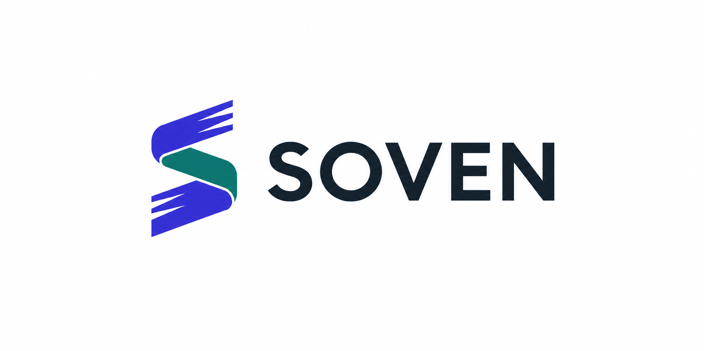
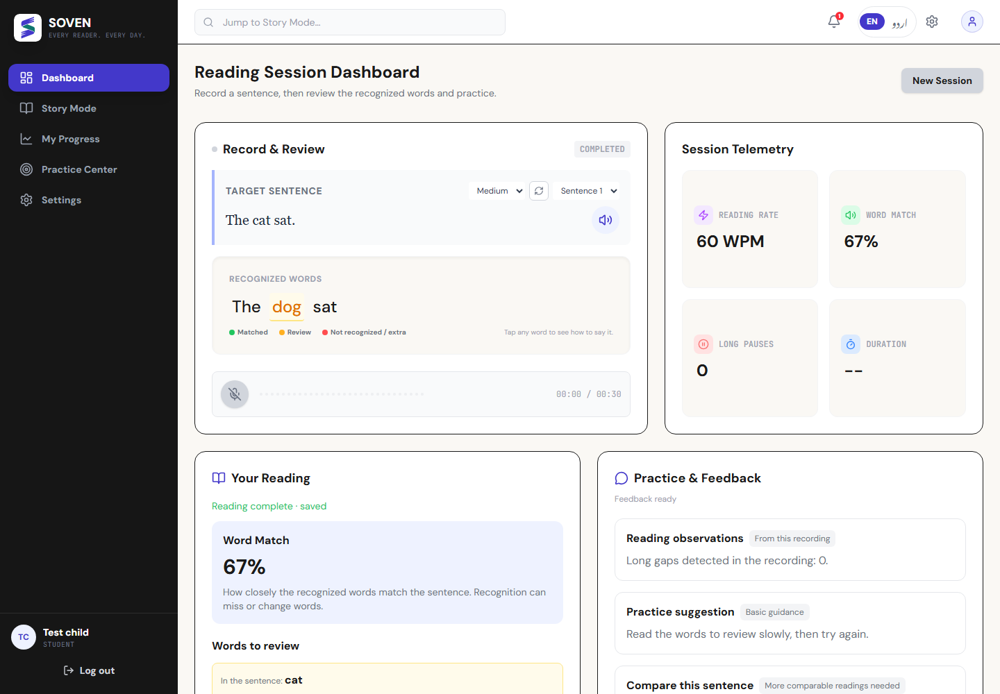

<p align="center"></p>

# SOVEN

SOVEN is a reading-practice platform with word-level feedback and teacher tools, building toward accessible storybook learning and **70+ languages**. English and Urdu are the current working reading tracks; broader coverage is planned.

**Current stage:** the repaired SpeakFlow baseline is imported under SOVEN branding. The new book UI, 70+ language rollout, introductory voice test and Meta runtime integration are planned; they are not active features yet.

[Start here](analysis/soven/00_START_HERE.md) · [Current state](analysis/soven/02_CURRENT_STATE.md) · [Setup](docs/SETUP.md) · [Roadmap](analysis/soven/07_IMPLEMENTATION_ROADMAP.md) · [Handoff documents](analysis/soven/DOCUMENT_MANIFEST.json)

## What works today

- Recorded reading with word-match feedback, target/recognized word comparisons and focused practice.
- English and Urdu reading paths, browser word/sentence playback and language-specific history.
- Teacher-managed classrooms, child signup and approval, optional existing-profile linking, roster analytics and reports.
- Classic dashboard, fixed story checkpoints and dynamic reading levels sharing reporting and scoring.
- Cached local Whisper support, explicit offline mode, bounded processing, persistent coaching and optional authenticated archival sync.
- Quiet page-flow warnings/errors, clear fallback labels and guarded recording/account lifecycles.

Hosted reasoning currently uses Google; online speech uses Groq with local Whisper fallback. No Meta integration is claimed by this branding delivery. Word match is transcript agreement, not validated pronunciation assessment or a dyslexia diagnosis.

## Current dashboard



These screenshots use synthetic validation accounts and controlled results.

## Quick start

Use Python 3.12, Node.js 20.9+ and FFmpeg. Keep credentials, recordings and databases private.

```powershell
cd backend
python -m venv .venv
.venv\Scripts\python -m pip install -r requirements-dev.txt
Copy-Item .env.example .env
.venv\Scripts\python scripts/bootstrap_teacher.py --username teacher
.venv\Scripts\python main.py
```

In a second terminal:

```powershell
cd frontend
npm ci
npm run build -- --webpack
npm start
```

Open http://localhost:3000. Bootstrap prompts for a new administrator password and prints the classroom signup code. There is no shared default login. Students use the code to sign up, and the teacher approves/links them from Students. On macOS/Linux use .venv/bin/python and cp. Never overwrite an existing private .env or database during setup. Windows users can use start_soven.bat; start_speakflow.bat remains a compatibility wrapper.

For offline reading, cache the selected Whisper model first and set OFFLINE_MODE=1. Microphone access needs localhost or HTTPS. Browser voice availability varies. Full configuration and deployment boundaries are in [SETUP](docs/SETUP.md).

## Verification

```powershell
python backend/tests/test_regressions.py
cd frontend
npm run lint
npx tsc --noEmit --incremental false
npm run build -- --webpack
```

[Validation and operations](analysis/soven/08_VALIDATION_AND_OPERATIONS.md) documents isolated browser checks, measured evidence and failures. [Latest exported-checkout results](analysis/soven/VALIDATION_RESULTS.json) and [CI](https://github.com/TeamXOF/soven/actions) distinguish completed checks from planned work.

Important limits remain: the prior child-speech holdout flagged 29/110 expert-acceptable words; a thirty-recording burst returned eight successes and twenty-two busy responses; Urdu speech quality, educator outcomes and public deployment remain unverified. The successful physical microphone take proves one tested workflow, not general accuracy. Do not repeat historical claims of solved autocorrection, phoneme diagnosis, emotion detection or universal offline operation.

## SOVEN roadmap

Planned: a simple landing/how-to flow, optional introductory sample, complete profiles, accessible responsive book pages, spoken coach turns, descriptive audio graphs, a staged 70+ language rollout including Spanish, and optional language-learning tools. The [requirements](analysis/soven/04_PRODUCT_REQUIREMENTS.md), [source review](analysis/soven/05_SOURCE_REVIEW.md) and [Meta plan](analysis/soven/06_META_PROVIDER_PLAN.md) explain dependencies and open decisions.

## Origin and license

SOVEN is derived from [TeamXOF/SpeakFlow Mesh](https://github.com/TeamXOF/speakflow-mesh), previously used in Alibaba and Build with Gemma hackathons. Waleed Khalid and TeamXOF retain attribution under the [MIT license](LICENSE). This independent repository starts with the repaired working baseline; [IMPORT_MANIFEST](analysis/soven/IMPORT_MANIFEST.json) records its source and file hashes. The earlier team repository is unchanged. This repository does not imply Meta endorsement, prior-code eligibility approval or a completed public deployment.

## Team development

The public repository is TeamXOF/soven. Follow the [live checklist](analysis/soven/07_IMPLEMENTATION_ROADMAP.md), [adopted defaults](analysis/soven/11_PRODUCT_DEFAULTS.md) and [execution log](analysis/soven/12_EXECUTION_LOG.md). The shared inventory contains 89 candidate languages; only English/Urdu reading is enabled. GET /api/v1/capabilities returns read-only language/provider status. Regenerate shared types with `python tools/build_language_types.py` and verify with `--check`.
